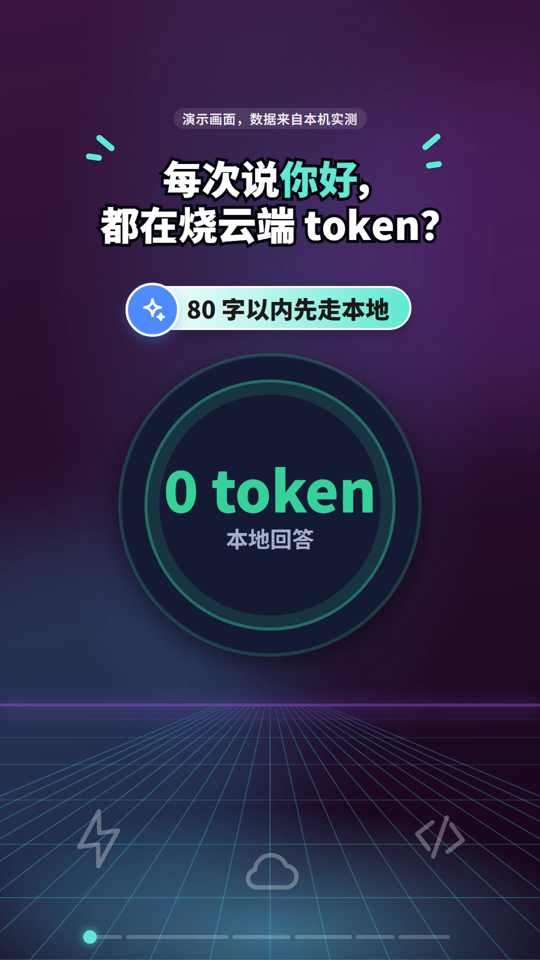
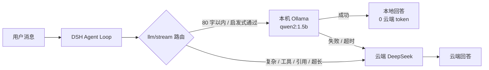

# dsh-local-router

> 把 80 字以内的简单问题交给本机 Ollama，复杂问题继续走云端 DeepSeek。  
> 一个给 [DeepSeek Harness](https://github.com/deepseek-ai/dsh) 用的本地优先路由插件。



---

## 创作目的

这个插件最早是为了解决一个很具体的问题：**QQ 群里大量低信息量、重复性的提问，正在持续消耗云端 token。**

群里每天都会有这类消息：

- “你好”
- “今天星期几”
- “XX 是什么意思”
- “帮我写个 hello world”
- 同一类问题换个人再问一遍

这些问题的答案并不需要云端大模型参与。但每次云端调用并不只发送那句“你好”，还会带上系统提示、群规则、技能目录、历史上下文等一大段内容。以本机实测的一个 QQ 群会话为例，一轮“你好”在界面里累计约 **4.9 万 token**（含多步与缓存读取）；钱花在这些问题上，既贵，又没有明显收益。

`dsh-local-router` 的做法很克制：

- 只处理 **80 字以内、没有明显复杂意图**的短消息；
- 命中后调用本机 Ollama 的 `/v1/chat/completions`，把本地回答作为正常的 assistant 消息返回；
- 复杂问题、工具/文件类请求、带图片/文件的请求、本地失败或超时，全部原样交给云端；
- 不阻止群友提问，也不替代群管理，只是把“不值得上云”的那部分留在本地。

> 它不是“让群友闭嘴”的工具，而是一个**成本路由**工具。  
> 群规、答疑、禁言、审批仍然应该由人和群管理完成。

---

## 它怎么工作



插件是 **Host 级**的，挂在 DeepSeek Harness 的 `llm/stream` 路由点上：

1. 用户消息进入 Agent Loop；
2. 插件读取当前请求，找到“最新一条人类用户消息”；
3. 用长度、关键词、工具意图、指代、代码块等轻量规则判断；
4. 简单问题 → 只把**这条用户消息 + 一个很小的系统提示**发给本地 Ollama，不发送完整群规则/历史；
5. 本地成功 → 生成 `block-start / text-delta / block-end / usage(0) / finish`，直接作为 assistant 流返回；
6. 本地失败、超时、模型为空 → 调用 `next()`，走原来的云端路径，不打断对话。

本地回答末尾会显示：

```text
> 本地模型 · qwen2:1.5b
```

这条标记是判断“有没有走本地”的最直接依据；该条消息的云端 token 用量应为 0。

---

## 主要功能

- **本地优先**：短、独立、自然语言问题走 Ollama。
- **复杂放行**：长消息、代码块、多行、工具/文件请求、上下文指代走云端。
- **静默降级**：本地不可达、超时、返回空 → 自动回退云端，不弹错、不阻塞。
- **启动预热**：`prewarm: true` 时插件启动/重载会发一个极小请求，提前加载模型。
- **Profile 级生效**：同一个 DSH profile 下的桌面会话、QQ 机器人会话、子代理都能用。
- **可配置**：地址、模型、阈值、关键词过滤、超时、冷却、来源标记均可改。
- **最小权限**：只访问回环地址上的 Ollama；不读写文件、不执行 shell、不读剪贴板、不碰凭据。
- **日志克制**：只记录 `decision=local/cloud`、原因码、耗时；不记录消息原文或回答。

---

## 安装

### 前置条件

- DeepSeek Harness `0.2.x`（在 `0.2.1-rc.3` 上验证）
- Node.js `>=22.15`
- 本机安装 [Ollama](https://ollama.com/)，并拉取一个模型：

```bash
ollama pull qwen2:1.5b
ollama serve
```

### 安装到 DSH profile

当前版本没有发布到 npm，使用本地 bundle 安装。

**方式一：DSH Desktop 插件管理页**

打开「插件」→ 安装 bundle → 选择本仓库目录（或输入绝对路径）。

**方式二：DSH CLI**

```bash
dsh plugin --profile desktop add "link:/absolute/path/to/dsh-local-router"
```

安装后，在 profile 的 `cordis.patch.yml` 中增加配置（见下一节），保存后通常会实时生效。

> 注意：`dsh-local-router` 是 DSH Host 插件，不是 QQ 机器人插件，也不是独立的 HTTP 代理。  
> QQ 机器人能否进群、是否有群聊权限，由 QQ 开放平台决定，不由本插件决定。

---

## 配置

在 `~/.dsh/profiles/<profile>/cordis.patch.yml` 追加：

```yaml
- id: local-router
  config:
    enabled: true
    baseUrl: http://localhost:11434
    model: qwen2:1.5b
    maxChars: 80
    keywordFilter: false
    timeoutMs: 20000
    cooldownMs: 5000
    prewarm: true
    showSourceBadge: true
```

> 一条匹配的 patch 会**替换整行 config**；本插件对缺失字段有默认值，所以只写想改的字段也可以。

### 字段说明

| 字段 | 默认值 | 说明 |
| --- | --- | --- |
| `enabled` | `true` | 总开关；`false` 时全部走云端 |
| `baseUrl` | `http://localhost:11434` | 仅接受 `localhost`、`127.*`、`::1` 的回环地址 |
| `model` | `qwen2:1.5b` | Ollama 中已拉取的模型名 |
| `maxChars` | `80` | 字符数上限（按 Unicode 字符计） |
| `keywordFilter` | `true` | 是否启用复杂意图关键词过滤；设为 `false` 更偏“按长度分流” |
| `timeoutMs` | `5000` | 单次本地请求超时；冷启动建议调大 |
| `cooldownMs` | `30000` | 本地失败后的冷却时间；建议 `5000`，避免第二条消息被长时间挡在本地之外 |
| `prewarm` | `true` | 插件启动/重载时预热模型；失败静默 |
| `maxAnswerChars` | `4000` | 本地回答最大字符数，超出截断 |
| `temperature` | `0.3` | 本地采样温度 |
| `maxTokens` | `512` | 本地最大输出 token |
| `timeZone` | 系统时区 | 注入本地系统提示的时区，例如 `Asia/Shanghai` |
| `systemPrompt` | 内置 | 自定义本地系统提示 |
| `showSourceBadge` | `true` | 在本地回答末尾追加 `> 本地模型 · <模型名>` |

### 常见改法

```yaml
# 临时全部走云端
- id: local-router
  config:
    enabled: false
```

```yaml
# 换成本机另一个模型
- id: local-router
  config:
    model: qwen2.5:1.5b
```

```yaml
# 关闭复杂关键词过滤，80 字以内优先本地
- id: local-router
  config:
    keywordFilter: false
    maxChars: 80
```

```yaml
# 关闭启动预热（不想让模型常驻内存时）
- id: local-router
  config:
    prewarm: false
```

```yaml
# 关闭本地来源标记
- id: local-router
  config:
    showSourceBadge: false
```

---

## 验证是否生效

1. 发一条短消息，例如“你好”。
2. 看回答末尾是否出现 `> 本地模型 · qwen2:1.5b`。
3. 看该条消息的云端 token 用量是否为 `0`。
4. 发一条复杂消息，例如“请分析一下 Rust 所有权机制的设计优劣”，应没有本地标记，且云端 token 用量非 0。
5. 临时把 `baseUrl` 指向 `http://127.0.0.1:9`，再发短消息：应静默回退云端，界面不报错、不卡死。

插件日志（`ctx.logger`）会记录例如：

```text
[local-router] prewarm=ok elapsedMs=1288
[local-router] decision=local elapsedMs=1340
[local-router] decision=cloud reason=complex-keyword elapsedMs=0
[local-router] decision=cloud reason=local-failed elapsedMs=5003
```

日志只包含决策、原因和耗时，不包含消息内容。

---

## 插件不足（诚实清单）

这个插件目前是 **v1.0.0 的早期版本**，不是生产级方案。以下问题真实存在：

### 路由判断

1. **只有启发式，没有语义理解**：长度、关键词、工具词、指代、代码块，都是规则；没有 embedding/分类器。
2. **80 字阈值是经验值**：短而复杂的问题可能被误判为本地；长而简单的问题会走云端。
3. **关闭 `keywordFilter` 后，短复杂问题也会走本地**：例如“请分析 Rust 所有权”只有 20 多字，会被本地模型接住；这是关闭关键词过滤后的取舍，不是 bug，但会牺牲回答质量。
4. **语言相关**：复杂/工具/指代词表以中英文为主，其他语言支持有限。
5. **不感知工具需求**：即使本地模型“想”用工具，它也没有工具；工具/文件类请求只是被规则挡回云端。
6. **不感知群聊上下文**：本地只收到“这一条用户消息 + 小系统提示”，不发送完整群规则/历史；需要上下文的问题不适合本地。

### 本地模型

7. **1.5B 模型能力有限**：事实性、实时性、推理、代码能力都弱；可能一本正经地胡说。
8. **没有实时数据**：天气、新闻、股价、版本号等，本地模型只能给通用回答；这类问题更适合云端/联网。
9. **没有工具/文件/浏览器能力**：本地模型不能读文件、跑命令、查网页。
10. **多轮记忆弱**：本地调用不带完整历史；指代类问题会被规则挡回云端，但规则不可能覆盖所有情况。

### 工程与体验

11. **不是流式输出**：当前实现等待本地模型完整生成后，再一次性发 `text-delta`；首字延迟 ≈ 本地完整生成时间，不是 token 级流式。
12. **冷启动/超时**：Ollama 模型闲置后会卸载；`prewarm` 只在插件启动/重载时做一次，之后仍可能冷启动。`timeoutMs` 太短会回退云端，太长会让用户等。
13. **没有每用户/每群预算、限流、缓存、去重**：它只做路由，不能保证整体成本下降；有人持续问长问题，仍然会走云端。
14. **没有 GUI 配置表单**：目前只能改 `cordis.patch.yml`；改错字段只能看日志排查。
15. **没有指标面板**：没有“本地命中率/节省 token/失败率/延迟”的统计；目前只能看单条消息的 badge 和 usage。
16. **没有 npm 发布**：通过本地 link / bundle 安装；版本管理和升级靠手动。
17. **测试覆盖有限**：只在 Windows 10 + DSH `0.2.1-rc.3` + Node 24 上实测；macOS/Linux/其他 DSH 版本未验证。
18. **依赖宿主内部 API**：`llm/stream` 是 DSH 的扩展点，升级后行为可能变化；插件需要跟着适配。
19. **模型元数据不准确**：`llm/stream` 短路不会改写请求头，所以那条消息的 `provider/model` 仍显示云端模型；实际没有发起云端请求，判断依据是 badge + 0 token。
20. **没有本地模型健康检查**：只靠请求失败/超时来发现 Ollama 不可用；没有主动探测、没有多模型 fallback 链。

### 平台与范围

21. **QQ 机器人接入不由本插件控制**：能否进群、群聊权限、沙箱群、事件订阅，由 QQ 开放平台决定；本插件只处理已经进入 DSH 的消息。
22. **QQ 群默认只推送 @ 机器人消息**：即使 `requireMention: false`，平台不推送的群消息插件也收不到；不要把它当成“监听全群”的工具。
23. **不是群管理/审核工具**：不会禁言、踢人、删消息、自动回复群规；它只是模型路由。
24. **不能阻止群友提问**：它降低的是“低价值问题的云端成本”，不是提问本身；群规和答疑仍需人工。

### 安全与隐私

25. **本地模型也会看到用户消息**：插件不把消息发到云端，但会发到本机 Ollama；Ollama 自身的日志/数据留存策略不在本插件控制范围内。
26. **Ollama 默认无鉴权**：插件只允许回环地址，但本机其他进程仍可能访问 11434；请自行保证本机环境可信。
27. **提示注入风险**：本地模型可能被用户消息诱导输出不当内容；由于没有工具权限，影响范围有限，但仍需自行评估。
28. **无内容审计**：插件不记录原文，也不做内容审核；如果群规要求留痕/审计，需要另做。

---

## 未来发展

优先级从高到低：

| 优先级 | 方向 | 具体想法 |
| --- | --- | --- |
| P0 | 成本控制 | 每群/每用户 token 预算、限流、重复问题缓存/FAQ、去重、命中率统计 |
| P0 | 路由质量 | 轻量语义分类器/embedding 路由；按语言、工具意图、上下文依赖动态判断 |
| P1 | 本地体验 | 本地流式输出；多轮短记忆；多模型 fallback（Ollama / LM Studio / vLLM / llama.cpp） |
| P1 | 可观测性 | 本地命中率、节省 token、失败率、P50/P95 延迟；Prometheus/OpenTelemetry 指标 |
| P2 | DSH 集成 | 图形化配置表单；Config schema；热更新；预设；更好的错误提示 |
| P2 | QQ 群策略 | 群级开关、`/local on/off` 管理命令、@ 触发、FAQ 自动回复、群白名单 |
| P3 | 质量与工程 | 单元/集成测试矩阵；Windows/macOS/Linux CI；npm 发布；签名 release |
| P3 | 隐私与安全 | 本地-only 模式、敏感信息脱敏、审计日志、Ollama 鉴权/健康检查 |
| P4 | 生态 | 英文文档、贡献指南、benchmark、与其他 DSH 插件/预设的兼容性清单 |

一个可能的中期形态：

- 插件不再只按“字数”判断，而是先做一次极轻量的语义/意图分类；
- 对重复问题直接返回缓存答案（0 模型调用）；
- 对每个群设置“每日本地/云端预算”，超过预算的请求给出提示；
- 管理员可以在群里用 `/local status`、`/local off` 控制；
- 所有决策有指标，能回答“到底省了多少 token、本地答错了多少”。

---

## 其他补充

- **这不是“省 token 银弹”**：它只把一部分短问题留在本地；复杂问题、长上下文、工具调用仍然会消耗云端 token。
- **不要把普通 QQ 账号当机器人挂进群**：请使用 QQ 开放平台的官方 Bot；加群、权限、审核按平台规则来，不要用“把账号设为管理员”的方式绕过。
- **不要用它羞辱或禁言群友**：它的目标是降低无意义云端开销，不是评价谁的问题“低级”；群规、答疑、审核仍应由人负责。
- **本地模型不是零成本**：省的是云端 token，付出的是本机 CPU/内存/电费，以及 1.5B 模型的质量上限。
- **敏感群先确认 Ollama 的日志策略**：消息会发给本机 Ollama，插件的“不记录”只覆盖插件自身日志，不覆盖 Ollama。
- **QQ 平台准入是前置条件**：机器人未上线、目标群不在沙箱、群聊权限未审核、事件未订阅，都会表现为“进不了群/不回复”，与本插件无关。

---

## 适用与不适用

**适合：**

- 已经在本机跑 Ollama，想减少 DSH/QQ 群云端 token 消耗；
- 群里有大量问候、常识、重复问题；
- 能接受本地 1.5B 模型的质量上限；
- 希望简单问题不离开本机，隐私/延迟更可控。

**不适合：**

- 需要高质量分析、代码、实时数据、工具调用的场景；
- 想用它替代群管理、审核、禁言、答疑机器人；
- 不能接受本地模型偶尔答错/答非所问；
- 希望“装上就保证省钱”的场景——它只优化路由，不承诺账单下降。

---

## 成本示例（不是承诺）

在一个 QQ 群会话里，一轮“你好”的界面用量示例约为 **4.9 万 token**（含多步与缓存读取）；同类问题走本地时，云端 token 为 **0**，代价是本机 CPU/内存和约 1–2 秒的本地生成时间。

实际节省取决于：

- 群消息里短问题的比例；
- 云端上下文有多大（系统提示、群规则、技能目录、历史）；
- 本地模型命中率；
- 你是否为本地模型付出电费/硬件成本。

请不要把示例数字当作账单承诺。

---

## 安全与隐私

- 只访问 `localhost` / `127.*` / `::1` 的 Ollama；`baseUrl` 不是回环地址时直接禁用分流。
- 不读写文件、不执行 shell、不访问剪贴板、不读取任何凭据。
- 不修改 DSH 的其他插件、模型选择或路由设置。
- 所有异常都被捕获；本地失败只退化为云端请求。
- 日志只记录决策/原因/耗时，不记录消息原文或回答。
- 本地调用只发送“最新用户消息 + 小系统提示”，不发送完整群规则/历史；这是隐私优势，也是上下文局限。

---

## 常见问题

### 为什么回答末尾没有 `> 本地模型`？

说明这条消息没有走本地。常见原因：

- 消息超过 `maxChars`；
- 含工具/文件/代码/指代词；
- 本地 Ollama 不可达/超时；
- 处于 `cooldownMs` 冷却期；
- 插件被禁用或未加载。

### 为什么模型标签仍显示 DeepSeek？

`llm/stream` 短路不会改写请求头，所以消息元数据仍显示云端 provider/model；实际没有发起云端请求。看 badge 和 token 用量更准确。

### Ollama 明明启动了，为什么还是走云端？

检查：

```bash
curl http://127.0.0.1:11434/api/version
curl http://127.0.0.1:11434/v1/models
```

确认 `baseUrl`、`model` 名称正确；第一次冷启动可能较慢，适当调大 `timeoutMs`。

### QQ 机器人进不了群 / QQ 提示不可以接入？

这是 QQ 开放平台的准入问题，不是本插件能解决的。检查：机器人是否发布上线、目标群是否在沙箱群列表、群聊消息权限是否审核通过、事件订阅是否包含 `GROUP_AT_MESSAGE_CREATE`、群类型是否支持机器人。机器人不是普通 QQ 账号，不能通过“邀请成员/设为管理员”的方式加入。

### 群聊里要 @ 机器人吗？

QQ 平台默认只推送 @ 机器人的群消息；插件里的 `requireMention: false` 只影响插件收到消息后的处理，不改变平台推送规则。

### 这个插件会替代群管理吗？

不会。它只决定“这条消息由本地还是云端回答”，不做禁言、踢人、删消息、审核或群规回复。

---

## 兼容性

- 已在 **Windows 10 x64**、**DSH 0.2.1-rc.3**、**Node 24.22.1**、**Ollama 0.40.11**、**qwen2:1.5b** 上实测。
- `llm/stream` 是 DSH 的扩展点，其他 DSH 版本/未来版本可能需要适配。
- 只支持 Ollama 的 OpenAI 兼容 `/v1/chat/completions`；其他本地服务如果兼容该接口，也可以试，但未验证。
- 不依赖 npm 运行时依赖；安装时只需要 DSH 能加载本包。

---

## 贡献

欢迎提 Issue / PR，尤其是：

- 更稳的路由判断（语义/embedding/工具意图）；
- 本地流式输出；
- 多后端适配；
- 指标/预算/缓存；
- QQ 群管理命令；
- macOS/Linux/其他 DSH 版本测试。

本地校验：

```bash
node --check index.js
node --test test/pure.test.mjs
# 需要本机 Ollama：
node --test test/router.test.mjs
```

---

## 作者

- 抖音：**进攻 D 点的沈凤翔**
- 项目：`dsh-local-router`
- 仓库地址：`https://github.com/tangcaolizhi/dsh-local-router`

## License

MIT。见 [LICENSE](LICENSE)。

> 本项目是社区作品，与 DeepSeek、腾讯/QQ 官方没有从属关系。  
> 使用前请自行评估本地模型质量、QQ 平台规则和群管理要求。
